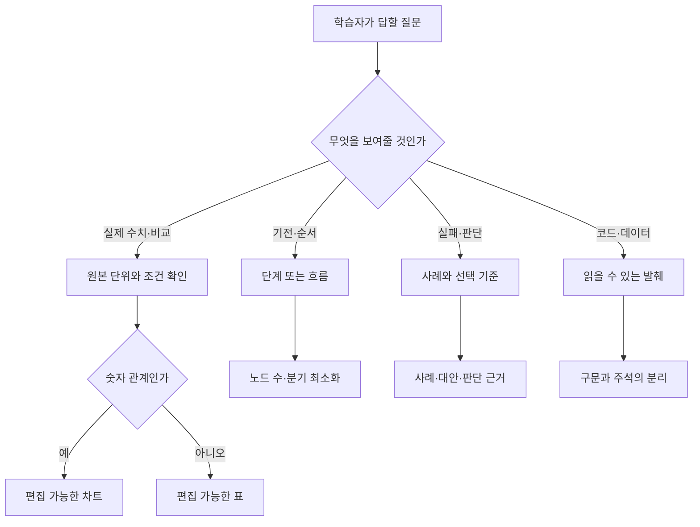

# LLMOps 강의 PPT 제작 가이드

## 설계 원칙

이 저장소의 강의안은 `scripts/course_deck_content.mjs`에 내용과 근거를, `scripts/presentation_design.mjs`에 색·서체·레이아웃 선택 규칙을, `scripts/build_course_deck.mjs`에 렌더러와 검증을 분리한다. 새 주차의 코드는 이전 장표를 복제하지 않고, 수강생이 답해야 할 질문과 증거의 형태부터 정한다.

## 내용에서 화면까지의 판단 트리

장표 종류는 `intent`(전제·구분·기전·증거·실습·판단)에서 고른다. `kind`는 내용 때문에 예외가 필요할 때만 명시한다. 표나 카드형 구성이 계속 이어지면, 인접 장표의 정보가 하나의 비교나 전환 질문으로 통합되는지 먼저 검토한다. 동일한 화면 구조가 세 장 연속이면 빌드 결과에 경고가 나온다.

## 레이아웃 선택

| 교육 시나리오 | 권장 화면 | 피할 패턴 |
|---|---|---|
| 개념 도입 | 큰 개념어와 짧은 정의 | 빈 장표를 채우기 위한 수식어 |
| 메커니즘 | 수평 흐름 또는 단계 | 내용 없는 3~4개 카드 |
| 실험 결과 | 단위·조건이 있는 차트 | 출처 없는 임의 수치 |
| 여러 기준 비교 | 원본 행·열이 남는 표, 열린 행 구분 | 모든 셀을 진한 격자로 가둔 표의 반복 |
| 코드·데이터 | 실제 실행 가능한 짧은 발췌 | 스크린샷으로 가린 코드 |
| 현업 판단 | 사례와 대안의 차이 | 근거 없는 승자 선언 |
| 실습 | 준비물·실행·확인 결과 | 수행할 수 없는 추상 지시 |

제목은 대상·개념을 직접 가리키는 명사형을 기본으로 한다. 본문은 최대한 구체적인 입력, 비교 조건, 실패 사례와 확인 방법으로 작성한다. 장표를 단순히 빽빽하게 채우려 하지 않는다. 반대로 근거가 짧은 내용은 여러 장으로 늘리지 않는다.

표는 셀 편집 가능성을 유지하되 모든 셀 테두리를 제거하고 얇은 가로 규칙으로 행만 구분한다. 머리글은 옅은 색, 첫 열은 굵은 글자로 위계를 만든다. 단위·조건·기준일이 필요한 숫자 표에는 해당 정보를 표 제목 또는 주석에 남긴다. 세로선이 꼭 필요한 복잡한 원본 자료는 예외적으로 허용하되, 단순 비교에서는 사용하지 않는다.

## 사실·자료 관리

- 수치·모델 성능·소프트웨어 호환성은 실행 조건과 출처를 기록한다. 2025 보존본의 실험을 현행 검증 결과로 표현하지 않는다.
- 합성 자료는 실제처럼 읽히되 실제 학생·고객·기업 정보나 API 키를 쓰지 않는다.
- 원본 그래프·표의 단위와 비교 기준을 유지한다. 슬라이드 노트의 `[Sources]`에 해당 근거를 남긴다.
- 아주대의 팀 제출과 다른 학교의 개인 제출은 현행 운영안과 소속별 공지를 구분한다.

## 빌드와 품질 확인

`load_workspace_dependencies`에서 Node·Python·패키지 경로를 확인한 뒤 `PRESENTATIONS_SKILL_DIR`, `ARTIFACT_PYTHON`, `RUNTIME_NODE_MODULES`, `RUNTIME_NODE`을 설정한다. 빌드 명령은 `"$RUNTIME_NODE" scripts/build_course_deck.mjs <주차>`다. 생성 결과는 `weekNN/lecture/`에 놓이고, 검증 리포트·초안은 무시되는 `weekNN/lecture/build/`에 남는다.

공통 렌더러를 수정한 뒤 기존 발표 자료를 덮어쓰지 않고 호환성만 확인할 때는 `"$RUNTIME_NODE" scripts/build_course_deck.mjs <주차> --no-publish`를 사용한다. 이 모드는 검증된 결과를 `build/`에 남기되 학생용 PPT와 강의 노트를 교체하지 않는다. 전체 내용 검사는 `"$RUNTIME_NODE" scripts/validate_course_decks.mjs`로 실행한다.

1. 제목 중복, 3장 연속 동일 레이아웃, 빠진 출처를 내용 단계에서 확인한다.
2. PPTX 구조·슬라이드 수·폰트·차트 무결성 검증을 통과한다.
3. LibreOffice PDF 변환 후 **모든 장표**를 같은 배율로 렌더링한다. 연락처·API 키·비공개 데이터도 확인한다.
4. 제목과 표 글자가 실제 투사 크기에서 읽히는지, 줄 바꿈·겹침·오탈자·차트 축을 눈으로 확인한다.
5. 강의 시간은 큰 구간만 표시한다. 세부 1분 단위 시간표는 발표자 노트에 둔다.

기존 4·5·8주차 결과물은 이번 6주차 참고안의 빌드와 별개다. 공통 렌더러를 바꾼 후 이들 자료를 다시 배포할 때는 각 주차 전체 PDF를 재생성하고 전 장표를 검수해야 한다.
